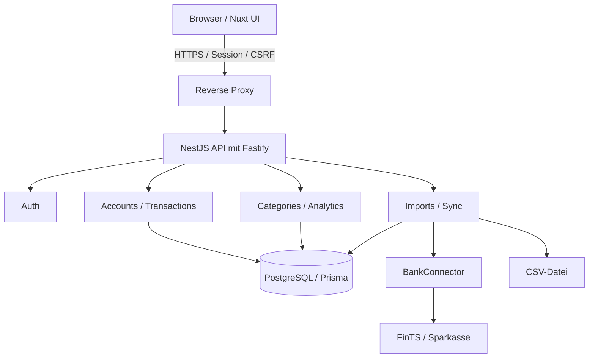
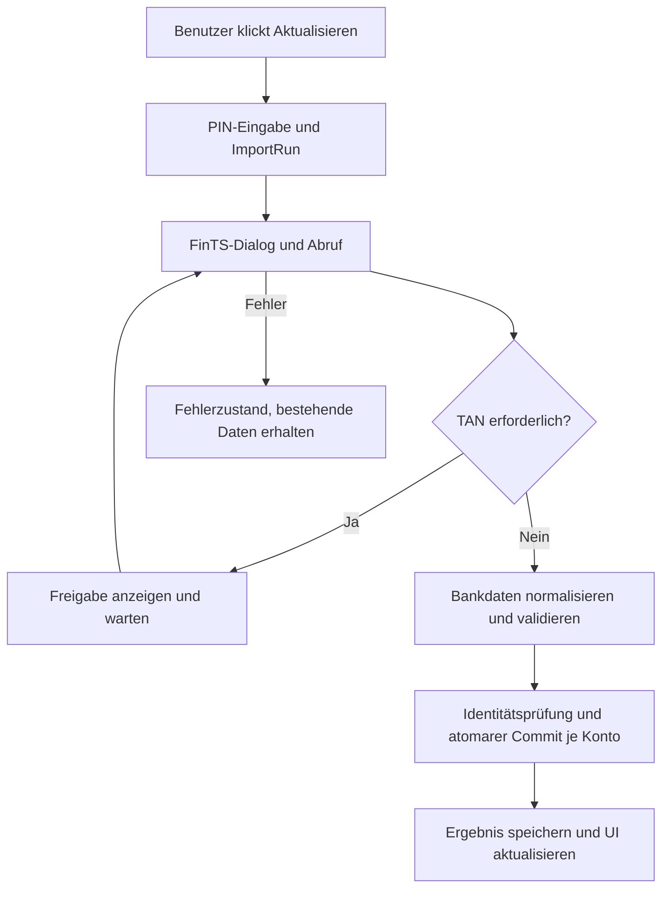

# Implementierungsspezifikation: Privates Haushaltsbuch mit Sparkassen-Anbindung

> **Statuskorrektur, 8. November 2026:** Historischer Plan bzw. damalige Checkliste. Aktueller Lieferstand: PR #11, `d193639`, gemergt und ausgerollt. Ausschließlich [Projektstand](status.md) und [aktuelle Aufgaben](todo.md) bewerten die heutige Erfüllung. Frühere Aussagen über fehlende Analysen/Regeln/Verträge, ausstehende Lieferungen oder leere Restore-Daten beschreiben damalige Zwischenstände. Ursprüngliche Prüfpunkte unten sind keine aktuelle Offen-Liste. Budgets B1–B5, Monatsplanung P1, Detailanforderungen C1–C3/A1 und externe Abnahmen bleiben dort ausdrücklich offen.

**Version:** 1.0  
**Zielplattform:** Linux / Docker Compose  
**Status:** Implementierungsspezifikation; FinTS-Kompatibilität noch zu prüfen

## 1. Projektdefinition

### 1.1 Zielsetzung

Entwicklung einer privaten, responsiven Webanwendung zur Verwaltung und Auswertung von Bankkonten und deren Umsätzen. Die Anwendung wird ausschließlich für einen Benutzer entwickelt, auf einem eigenen Linux-Server betrieben und über das Heimnetz beziehungsweise ein VPN aufgerufen.

**Kernfunktionen:**

1. Bankkonten über FinTS 3.0 anbinden oder alternativ Umsätze über CSV importieren.
2. Kontostände und Umsätze dauerhaft speichern.
3. Neue Bankumsätze zuverlässig erkennen und Dubletten vermeiden.
4. Umsätze manuell kategorisieren.
5. Einnahmen, Ausgaben und Salden pro Monat auswerten.
6. Umbuchungen zwischen eigenen Konten markieren und von Einnahmen-/Ausgabensummen ausschließen.
7. Synchronisationsvorgänge und Fehler nachvollziehbar anzeigen.
8. Daten schützen und regelmäßig sichern.

**Nicht Teil von v1:** Überweisungen, Depots, Budgets, Sparziele, Prognosen und automatische Kategorisierungsregeln.

### 1.2 Technologie-Stack

| Komponente | Technologie | Festlegung |
|---|---|---|
| Backend | NestJS + Fastify | REST-API |
| Frontend | Nuxt + Nuxt UI | Responsive Web-App |
| Datenbank | PostgreSQL | Relationale Persistenz |
| ORM | Prisma | Schema und Migrationen |
| Sprache | TypeScript | Strict Mode |
| Paketverwaltung | pnpm | Workspace-Monorepo |
| Validierung | class-validator / class-transformer | Backend-DTOs |
| API-Vertrag | OpenAPI | Generierter Frontend-Client |
| Authentifizierung | Argon2id + Sessions | Serverseitige Sessions |
| Bankintegration | FinTS 3.0 | Adapter mit `lib-fints` |
| CSV-Import | Serverseitiger Parser | Gemeinsame Importpipeline |
| Tests | Vitest oder Jest, Playwright | Unit, Integration, E2E |
| Deployment | Docker Compose | Linux-Server |
| HTTPS | Reverse Proxy | TLS-Terminierung |
| CI | GitHub Actions | Qualitätsprüfungen |

Konkrete kompatible Paketversionen werden bei Projektbeginn festgelegt und über `pnpm-lock.yaml` eingefroren. Major-Upgrades erfolgen nicht automatisch.

### 1.3 Nichtfunktionale Anforderungen

| ID | Anforderung | Abnahmekriterium |
|---|---|---|
| NFR-01 | Ein Benutzer | Keine öffentliche Registrierung, keine Mandantenverwaltung |
| NFR-02 | Private Erreichbarkeit | Kein Zugriff außerhalb Heimnetz/VPN |
| NFR-03 | Responsivität | Bedienbar ab 360 px |
| NFR-04 | Währung | Ausschließlich EUR in v1 |
| NFR-05 | Genauigkeit | Integer-Cent statt Gleitkommazahlen |
| NFR-06 | Zuverlässigkeit | Keine Dubletten bei eindeutig identifizierbaren Wiederholungsimporten |
| NFR-07 | Sicherheit | Keine PIN/TAN in Persistenz oder Logs |
| NFR-08 | Datenhaltung | Fehlgeschlagene Abrufe verändern bestehende Daten nicht |
| NFR-09 | Sprache | Deutsche Oberfläche, Daten- und Zahlenformate |
| NFR-10 | Wartbarkeit | Typisierung, Migrationen, Tests, Dokumentation |

### 1.4 Verbindliche Annahmen

- Ein Benutzer kann beliebig viele eigene Konten verwalten.
- Eine Bankverbindung kann mehrere Konten enthalten.
- Ein Konto kann Umsätze aus FinTS und CSV erhalten.
- Die Bankanbindung ist ausschließlich lesend.
- Ein gescheiterter FinTS-Nachweis blockiert CSV nicht.
- Vorgemerkte Umsätze werden nur unterstützt, wenn die Quelle sie zuverlässig liefert.
- Historische Salden werden nur als solche angezeigt, wenn sie tatsächlich von der Quelle geliefert wurden.
- Manuelle Kategorien und Umbuchungsmarkierungen werden lokal verwaltet und bei Importen nicht überschrieben.

## 2. Architektur

### 2.1 Systemübersicht



### 2.2 Monorepo-Struktur

```text
haushaltsbuch/
├── apps/
│   ├── api/
│   │   ├── src/
│   │   │   ├── auth/
│   │   │   ├── accounts/
│   │   │   ├── transactions/
│   │   │   ├── categories/
│   │   │   ├── analytics/
│   │   │   ├── imports/
│   │   │   ├── banking/
│   │   │   │   ├── connectors/
│   │   │   │   ├── fints/
│   │   │   │   └── sync/
│   │   │   ├── common/
│   │   │   └── main.ts
│   │   ├── prisma/
│   │   │   ├── schema.prisma
│   │   │   └── migrations/
│   │   └── test/
│   └── web/
│       ├── pages/
│       ├── components/
│       ├── composables/
│       ├── middleware/
│       ├── layouts/
│       └── plugins/
├── packages/
│   ├── api-client/
│   ├── shared/
│   └── config/
├── infrastructure/
│   ├── compose.yaml
│   ├── proxy/
│   └── backup/
├── docs/
│   ├── architecture.md
│   ├── banking.md
│   ├── api.md
│   ├── deployment.md
│   └── recovery.md
├── .github/workflows/
├── pnpm-workspace.yaml
├── package.json
└── pnpm-lock.yaml
```

### 2.3 Architekturregeln

- Controller enthalten keine Geschäftslogik; Services implementieren Geschäftsregeln.
- Prisma-Zugriffe erfolgen ausschließlich im Backend über Services/Repositories.
- Bankbibliotheken werden ausschließlich durch Connector-Adapter eingebunden.
- Frontend-Komponenten greifen nie direkt auf die Datenbank zu.
- API-DTOs sind von Prisma-Persistenztypen getrennt.
- Externe Daten werden vor der Persistierung validiert und normalisiert.
- FinTS und CSV verwenden dieselbe fachliche Importpipeline.

## 3. Datenmodell

### 3.1 Entitäten

| Entität | Zweck | Wichtige Felder |
|---|---|---|
| User | Administrativer Benutzer | ID, Loginname, Passwort-Hash, Aktivstatus |
| Session | Login-Sitzung | Token-Hash, User-ID, Ablaufzeit |
| BankConnection | Bankverbindung | ID, Bankname, BLZ, Connector-Typ |
| Account | Bankkonto | ID, Verbindung, IBAN, Währung, Name |
| BalanceSnapshot | Bankgemeldeter Saldo | Konto, Betrag, Zeitpunkt, Typ |
| Transaction | Umsatz | Konto, Betrag, Buchungsdatum, Text, Status |
| Category | Kategorie | ID, Name, Typ, Farbe |
| ImportRun | Import-/Synchronisationslauf | Quelle, Status, Zeitpunkte, Zähler |
| ImportIssue | Importwarnung/Fehler | Lauf, Zeile/Datensatz, Fehlercode |
| TransactionIdentity | Umsatzidentität | Umsatz, Quellreferenz, Fingerprint |
| TransferGroup | Verknüpfung von Umbuchungen | ID, Status |
| SyncCursor | Erfolgreich abgerufener Zeitraum | Konto, letzter Zeitraum |
| SyncChallenge | Flüchtige TAN-Freigabe | Nur Arbeitsspeicher, nicht Prisma |

### 3.2 Felder und Regeln

**User:** Genau ein aktiver Benutzer in v1. Passwort mit Argon2id hashen; keine öffentliche Registrierungs-API.

**BankConnection:** `id` UUID, `name` String, `bankCode` achtstelliger String, `connectorType` (`FINTS | CSV`), `status` (`ACTIVE | DISABLED | BLOCKED`), `createdAt`, `updatedAt`. Keine PIN/TAN. CSV kann einem bestehenden FinTS-Konto zugeordnet werden.

**Account:** `id` UUID, `bankConnectionId` UUID, `iban` nullable, `bankAccountReference` nullable, `name`, `currency = EUR`, `accountType` (`CHECKING | SAVINGS | OTHER`), `isActive`, `lastSuccessfulSyncAt` nullable. Konten werden durch stabile Bankreferenz oder bestätigte manuelle Zuordnung identifiziert.

**BalanceSnapshot:** `id`, `accountId`, `amountCents` BigInt, `balanceType` (`BOOKED | AVAILABLE`), `observedAt`, `source` (`FINTS | CSV`), `importRunId`. Gebuchte und verfügbare Salden getrennt speichern. Ohne Quellsaldo keinen Saldo erfinden.

**Transaction:** `id`, `accountId`, `amountCents` BigInt, `currency = EUR`, `bookingDate` Date, `valueDate` nullable, `description`, `counterpartyName` nullable, `counterpartyIban` nullable, `status` (`BOOKED | PENDING`), `categoryId` nullable, `transferGroupId` nullable, `createdAt`, `updatedAt`. Positive Beträge = Eingang, negative = Ausgang. Nullbeträge nur bei tatsächlich relevanten Buchungen.

**Category:** `id`, `name`, `kind` (`INCOME | EXPENSE | BOTH`), `color` nullable, `isSystem`, `sortOrder`. Import überschreibt Kategorien nie. Löschen verwendeter Kategorien erfordert Bestätigung und setzt die Zuordnung auf „Nicht kategorisiert“.

### 3.3 Constraints und Indizes

- Fremdschlüssel für alle Beziehungen.
- Unique auf `User.username`.
- Eindeutige normalisierte Kontoreferenzen in ihrem fachlichen Geltungsbereich.
- Unique auf `(accountId, identityType, identityValue)` für verifizierte Umsatzidentitäten.
- Index `(accountId, bookingDate DESC, id DESC)`.
- Index auf `Transaction.categoryId` und `ImportRun.startedAt`.
- Keine Zusammenführung nur aufgrund identischer Beträge, Datumswerte oder Texte.
- `BIGINT`-Centwerte werden in der JSON-API als dezimale Strings übertragen.

## 4. Bankanbindung und Synchronisation

### 4.1 FinTS-Kompatibilitätsnachweis

**Zielinstitut:** Sparkasse Bodensee, BLZ `69050001`.

| Prüfung | Erfolgskriterium |
|---|---|
| Produkt-ID | Eigene gültige FinTS-Produktkennung verfügbar |
| Endpunkt | Offizieller Bankendpunkt bestätigt |
| Initialisierung | Bankdialog aufgebaut |
| Authentifizierung | Gültige Zugangsdaten akzeptiert |
| TAN-Verfahren | Unterstütztes Verfahren erkannt |
| Kontoliste | Mindestens ein Konto abrufbar |
| Saldo | Gebuchter Kontostand korrekt geliefert |
| Umsätze | Historische Buchungen abrufbar |
| Freigabe | TAN-/App-Freigabe abgeschlossen |
| Abbruch | Timeout und Abbruch definiert behandelt |

Die Fähigkeiten von [`lib-fints`](https://github.com/robocode13/lib-fints) sind im Proof of Concept praktisch zu prüfen. Die Sparkasse beschreibt ihre [PSD2-Schnittstelle](https://www.sparkasse-bodensee.de/de/home/aktionen/psd2.html) für zugelassene Drittdienste; eine direkte PSD2-Integration wird in v1 nicht geplant. Bei negativem FinTS-Nachweis wird der CSV-Weg fertiggestellt und die Live-Anbindung als blockiert dokumentiert.

### 4.2 Connector-Interface

```ts
export interface BankConnector {
  getCapabilities(): ConnectorCapabilities;
  discoverAccounts(context: BankRequestContext): Promise<BankAccountInfo[]>;
  getBalances(context: BankRequestContext, account: BankAccountInfo): Promise<BankBalance[]>;
  getTransactions(
    context: BankRequestContext,
    account: BankAccountInfo,
    range: DateRange
  ): Promise<BankTransactionPage>;
  continueChallenge?(
    context: BankRequestContext,
    response: ChallengeResponse
  ): Promise<void>;
  cancel?(context: BankRequestContext): Promise<void>;
}
```

Dies ist ein fachlicher Zielvertrag, kein Nachweis der konkreten Bibliotheksmethoden. `ConnectorCapabilities` kennzeichnet Kontenermittlung, Salden, Umsätze, vorgemerkte Umsätze, interaktive TAN-Freigabe und Abbruch. Nicht unterstützte Funktionen werden als `false` markiert. `BankRequestContext` enthält flüchtige Authentifizierung, Abruf-ID, Abbruchsignal und Bankparameter.

### 4.3 Synchronisationsablauf



### 4.4 Zustandsmaschine

```ts
type ImportRunStatus =
  | 'CREATED'
  | 'RUNNING'
  | 'WAITING_FOR_AUTH'
  | 'COMMITTING'
  | 'COMPLETED'
  | 'PARTIAL_SUCCESS'
  | 'FAILED'
  | 'CANCELLED';
```

| Zustand | Bedeutung | Zulässige Folge |
|---|---|---|
| CREATED | Lauf angelegt | RUNNING, CANCELLED |
| RUNNING | Abruf läuft | WAITING_FOR_AUTH, COMMITTING, FAILED, CANCELLED |
| WAITING_FOR_AUTH | Freigabe ausstehend | RUNNING, FAILED, CANCELLED |
| COMMITTING | Validierte Daten werden gespeichert | COMPLETED, PARTIAL_SUCCESS, FAILED |
| COMPLETED | Alle Konten erfolgreich | Endzustand |
| PARTIAL_SUCCESS | Einige Konten erfolgreich | Endzustand |
| FAILED | Abruf/Verarbeitung gescheitert | Endzustand |
| CANCELLED | Benutzerabbruch | Endzustand |

Abgeschlossene Läufe werden nie erneut gestartet; neue Abrufe erhalten neue UUIDs.

### 4.5 Nebenläufigkeit und Neustart

- Pro Bankverbindung höchstens ein aktiver FinTS-Abruf.
- PostgreSQL-koordinierte Sperre mit zeitlich begrenzter Lease und Erneuerung.
- Verwaiste Läufe nach Serverneustart als fehlgeschlagen markieren.
- Neustart während TAN-Freigabe bricht den Abruf ab; erneute PIN-Eingabe erforderlich.
- Keine persistierten Geheimnisse für Dialogwiederherstellung.
- Datenbanktransaktionen erst nach vollständigem Abruf und Validierung des jeweiligen Kontos starten; niemals Netzwerkaufrufe innerhalb dieser Transaktionen.

### 4.6 Abrufzeiträume

- **Erstimport:** 90 Kalendertage rückwirkend; Benutzer kann Starttermin wählen, sofern Bank unterstützt.
- **Folgeimport:** Ab letztem erfolgreichen Buchungsdatum minus 14 Tage bis heute.
- **Historischer Import:** Gewählter Zeitraum, bei Bedarf in bankseitig unterstützte Intervalle aufgeteilt.
- Separater `SyncCursor` je Konto; bei Fehler nicht fortschreiben.
- Zeitraum erst als erfolgreich markieren, wenn alle Seiten/Teilabrufe verarbeitet sind.

### 4.7 Fehlercodes

| Code | Anzeige / Verhalten |
|---|---|
| BANK_INVALID_CREDENTIALS | Zugangsdaten abgelehnt; kein Auto-Retry |
| BANK_AUTH_REQUIRED | Freigabeansicht anzeigen |
| BANK_AUTH_REJECTED | Freigabe abgelehnt; Lauf beenden |
| BANK_AUTH_TIMEOUT | Zeitüberschreitung; Lauf beenden |
| BANK_UNAVAILABLE | Bank nicht erreichbar; Daten erhalten |
| BANK_RATE_LIMITED | Bankabruf begrenzt; Wartehinweis |
| BANK_UNSUPPORTED | Nicht unterstützte Funktion dokumentieren |
| BANK_INVALID_RESPONSE | Unvollständige Daten nicht übernehmen |
| SYNC_ALREADY_RUNNING | Weiteren Abruf ablehnen |
| SYNC_CANCELLED | Temporäre Daten verwerfen |

Keine rohen FinTS-Nachrichten, Geheimnisse oder Stacktraces im Frontend.

## 5. CSV-Import

### 5.1 Ablauf

1. Datei hochladen.
2. Codierung, Trennzeichen und Spaltenzuordnung erkennen oder bestätigen.
3. Vorschau und Validierung anzeigen.
4. Import ausdrücklich bestätigen und Ergebnis ausgeben.

### 5.2 Formate und Grenzen

- UTF-8, UTF-8 mit BOM, Windows-1252.
- Semikolon/Komma, übliche CSV-Quoting-Regeln.
- Deutsche Beträge (`1.234,56`, `-49,90`).
- Separate Soll-/Haben-Spalten optional.
- Datumsformate `DD.MM.YYYY`, `YYYY-MM-DD`.
- Maximal 10 MiB und 50.000 Datenzeilen, konfigurierbar.

### 5.3 Spalten

| Feld | Pflicht | Regel |
|---|---|---|
| Buchungsdatum | Ja | Ungültig = Zeilenfehler |
| Betrag | Ja | Integer-Cent |
| Buchungstext | Ja | Leer = Zeilenfehler |
| Wertstellungsdatum | Nein | Sonst `null` |
| Gegenpartei | Nein | Optional |
| Gegenkonto-IBAN | Nein | Optional |
| Bankreferenz | Nein | Für Identität bevorzugt |
| Saldo | Nein | Nur bei eindeutiger Zuordnung |

### 5.4 Importregeln

- Vorschau und Commit sind getrennte API-Aktionen.
- Zielkonto wird ausdrücklich gewählt.
- Vorschau und Commit nutzen dieselbe Normalisierung/Validierung.
- Fehlerhafte Zeilen mit Zeilennummer und Fehlercode anzeigen.
- Teilimport nur nach ausdrücklicher Bestätigung.
- Schwerwiegende Strukturfehler lehnen die gesamte Datei ab.
- Temporäre Upload-Dateien nach Abschluss/Abbruch löschen.

## 6. Umsatzidentität und Dublettenerkennung

### 6.1 Prioritäten

1. **Stabile eindeutige Bankreferenz** zusammen mit Konto und Referenztyp.
2. **Bekannte Quellenidentität** einer wiederholten CSV- oder FinTS-Buchung. Dateihash allein genügt nicht.
3. **Ähnlichkeitsprüfung** über Konto, Betrag, Buchungs-/Wertstellungsdatum, Gegenkonto, Gegenpartei und normalisierten Text. Keine automatische Zusammenführung.

```ts
type IdentityResolution =
  | { kind: 'EXACT_MATCH'; transactionId: string }
  | { kind: 'NEW' }
  | { kind: 'REVIEW_REQUIRED'; candidateIds: string[] };
```

- `EXACT_MATCH`: Keine manuellen Kategorien/Umbuchungsmarkierungen überschreiben.
- `NEW`: Neuen Umsatz anlegen.
- `REVIEW_REQUIRED`: Im Staging halten, Benutzer entscheiden lassen.
- Vorgemerkte Buchung und spätere Buchung nur bei zuverlässiger Referenz automatisch verbinden.
- Identitätsprüfung innerhalb einer Datenbanktransaktion; Unique-Constraints verhindern Rennen.
- Zwei tatsächlich unterschiedliche Buchungen mit identischem Betrag, Datum und Text bleiben getrennt.

## 7. Kategorien und Umbuchungen

### 7.1 Standardkategorien

| Ausgaben | Einnahmen |
|---|---|
| Lebensmittel | Gehalt |
| Wohnen | Erstattung |
| Mobilität | Zinsen |
| Versicherungen | Sonstige Einnahmen |
| Gesundheit | |
| Freizeit | |
| Shopping | |
| Abonnements | |
| Sonstige Ausgaben | |

- Pro Umsatz höchstens eine Kategorie.
- Manuelle Einzel- und Mehrfachzuordnung.
- Nicht kategorisierte Umsätze sichtbar.
- Kategorien umbenennen, deaktivieren, ergänzen.
- Import verändert manuelle Zuordnung nicht.
- Keine automatische Kategorisierung in v1.

### 7.2 Umbuchungen

- Manuell markieren und optional zwei passende Buchungen in einer `TransferGroup` verbinden.
- Gruppe enthält höchstens einen Ausgang und einen Eingang unterschiedlicher eigener Konten.
- Bei vollständig abgebildeter EUR-Umbuchung müssen Beträge betragsgleich und entgegengesetzt sein.
- Einzelmarkierung möglich, wenn Gegenseite fehlt.
- Umbuchungen in Umsatzlisten zeigen, aus Einnahmen-/Ausgabensummen ausschließen.
- Keine automatische Erkennung nur wegen passender Beträge.

## 8. Monatsauswertungen

Nur `BOOKED`-Umsätze, Zuordnung über `bookingDate`, ohne als Umbuchung markierte Umsätze. Für die Menge \(T_m\) der relevanten Umsätze im Monat:

**Einnahmen:**

\[
E_m = \sum_{t \in T_m} \max(t.amountCents, 0)
\]

**Ausgaben:**

\[
A_m = \sum_{t \in T_m} \max(-t.amountCents, 0)
\]

**Monatssaldo:**

\[
S_m = E_m - A_m
\]

**Monatsvergleich:**

\[
\Delta S = S_m - S_{m-1}
\]

- Rückerstattungen werden standardmäßig nach positivem Vorzeichen als Einnahmen ausgewiesen.
- Kategorienauswertung: Einnahmen, Ausgaben, Buchungsanzahl, prozentualer Anteil.
- Nicht kategorisierte Umsätze bilden eine eigene Gruppe.
- Prozentanteil bei Gesamtsumme null = `null`.
- Cent-genaue Berechnung; Prozentwerte nur bei Anzeige runden.
- Banksaldo und Summe lokal vorhandener Umsätze sind unabhängig.

## 9. REST-API

### 9.1 Konventionen

- Basis: `/api/v1`; JSON, UTF-8.
- UUIDs als öffentliche IDs.
- Zeitpunkte ISO-8601 UTC, Buchungsdaten `YYYY-MM-DD`.
- Geldbeträge als dezimale Integer-Cent-Strings.
- Cursor-Pagination, limit 1–100, Standard 50.
- DTOs getrennt von Prisma-Modellen.
- OpenAPI-Dokumentation und automatisch generierter Client.
- Einheitliches Fehlerformat.

### 9.2 Endpunkte

| Methode | Endpunkt | Funktion |
|---|---|---|
| POST | `/auth/login` | Anmelden |
| POST | `/auth/logout` | Abmelden |
| GET | `/auth/session` | Session prüfen |
| GET | `/accounts` | Konten auflisten |
| GET | `/accounts/:id` | Kontodetails |
| PATCH | `/accounts/:id` | Anzeigename/Aktivstatus ändern |
| GET | `/accounts/:id/balances` | Saldoverlauf |
| GET | `/transactions` | Umsätze filtern/paginieren |
| GET | `/transactions/:id` | Umsatzdetails |
| PATCH | `/transactions/:id` | Kategorie/Umbuchungsmarkierung |
| POST | `/transactions/bulk-category` | Mehrfachkategorisierung |
| GET | `/categories` | Kategorien auflisten |
| POST | `/categories` | Kategorie erstellen |
| PATCH | `/categories/:id` | Kategorie bearbeiten |
| DELETE | `/categories/:id` | Kategorie löschen |
| GET | `/analytics/monthly` | Monatsauswertung |
| GET | `/bank-connections` | Verbindungen |
| POST | `/bank-connections` | Verbindung konfigurieren |
| PATCH | `/bank-connections/:id` | Verbindung bearbeiten |
| POST | `/bank-connections/:id/sync` | Synchronisation starten |
| GET | `/import-runs/:id` | Laufstatus |
| POST | `/import-runs/:id/challenge` | TAN-Freigabe fortsetzen |
| POST | `/import-runs/:id/cancel` | Abbrechen |
| POST | `/imports/csv/preview` | CSV-Vorschau |
| POST | `/imports/csv/:id/commit` | CSV übernehmen |
| GET | `/imports/:id/issues` | Importprobleme |
| POST | `/imports/:id/resolutions` | Dublettenentscheidungen |
| POST | `/transfers` | Umbuchungen verknüpfen |
| DELETE | `/transfers/:id` | Verknüpfung aufheben |

### 9.3 Umsatzfilter

`GET /api/v1/transactions?accountId=...&from=2026-10-01&to=2026-10-31&categoryId=...&status=BOOKED&limit=50`

Filter: Konto/Konten, Zeitraum, Kategorie, Status, Suchtext, Einnahme/Ausgabe, nicht kategorisiert, Umbuchungen ein-/ausschließen. Suche über Buchungstext und Gegenpartei; Standardsortierung `bookingDate DESC, id DESC`.

### 9.4 Beispielantwort

```json
{
  "items": [
    {
      "id": "0d93b0aa-3d22-4f8c-9e6e-3b4b50c49e72",
      "accountId": "cb3f6dc6-4e89-42b8-9391-7d8d0c348d1a",
      "bookingDate": "2026-10-15",
      "valueDate": "2026-10-15",
      "amountCents": "-4990",
      "currency": "EUR",
      "description": "Beispiel Einkauf",
      "counterpartyName": "Beispielmarkt",
      "status": "BOOKED",
      "categoryId": null,
      "isTransfer": false
    }
  ],
  "nextCursor": null
}
```

### 9.5 Fehlerformat und HTTP-Status

```json
{
  "error": {
    "code": "SYNC_ALREADY_RUNNING",
    "message": "Für diese Bankverbindung läuft bereits ein Abruf.",
    "requestId": "7b3dbe2e-56e4-4f44-bc91-246bd1d30a2a",
    "details": {}
  }
}
```

| HTTP | Bedeutung |
|---|---|
| 200 | Erfolgreich |
| 201 | Erstellt |
| 202 | Asynchron gestartet |
| 204 | Erfolgreich ohne Inhalt |
| 400 | Ungültige Anfrage |
| 401 | Nicht angemeldet |
| 403 | Keine Berechtigung / CSRF |
| 404 | Nicht gefunden |
| 409 | Konflikt |
| 413 | Datei zu groß |
| 422 | Fachlich ungültig |
| 429 | Zu viele Anfragen |
| 500 | Interner Fehler |
| 502/503 | Bankfehler / Nichtverfügbarkeit |

Alle fachlichen Endpunkte benötigen Session; ändernde Requests benötigen CSRF-Nachweis; restriktive Origin-/CORS-Policy.

## 10. Benutzeroberfläche

### 10.1 Routen

| Route | Funktion |
|---|---|
| `/login` | Anmeldung |
| `/` | Dashboard |
| `/transactions` | Umsatzliste |
| `/transactions/:id` | Umsatzdetails |
| `/accounts` | Kontoübersicht |
| `/accounts/:id` | Kontodetails |
| `/categories` | Kategorien |
| `/imports` | Importhistorie |
| `/imports/csv` | CSV-Assistent |
| `/connections` | Bankverbindungen / FinTS |
| `/settings` | Einstellungen |

### 10.2 Dashboard

- Summe aktuell bekannter gebuchter Kontostände mit Zeitstempel.
- Einnahmen, Ausgaben und Monatssaldo des gewählten Monats.
- Vergleich zum Vormonat.
- Kategorienauswertung.
- Letzte zehn gebuchte Umsätze.
- Synchronisationsstatus und „Aktualisieren“.
- Fehlende/veraltete Salden kennzeichnen; fehlende Salden nie als `0,00 €` ausgeben.

**Illustrative Beispieldaten:** Kontostände 8.450,00 €, Einnahmen 3.200,00 €, Ausgaben 2.580,00 €, Monatssaldo +620,00 €. Kategorien: Wohnen 1.050 €, Lebensmittel 620 €, Mobilität 390 €, Sonstiges 520 €.

### 10.3 UI-Regeln

- Jede Datenansicht unterstützt Loading, Empty, Success, Error.
- Filter nach Möglichkeit in URL speichern; Monatsauswahl erhalten.
- Mobilgerechte Umsatzdetails; keine Layoutfehler durch lange Texte.
- Tastaturbedienbarkeit und sichtbarer Fokus.
- Dialoge über Escape schließen, sofern kein kritischer Commit läuft.
- Aktualisieren während eines laufenden Abrufs deaktivieren.
- Seiten-Reload löst keinen neuen Bankabruf aus.
- PIN/TAN nicht in Pinia, `localStorage`, `sessionStorage`, Cookies oder URL halten.

### 10.4 Synchronisationsdialog

- PIN-Eingabe und Status.
- TAN-Verfahren/Freigabeanweisung bei Bedarf.
- Verbleibende Wartezeit nur wenn zuverlässig bekannt.
- Abbrechen.
- Ergebnis mit neuen, bekannten, prüfbedürftigen Umsätzen.
- Verständliche Fehlertexte.
- PIN/TAN-Felder nach Abschluss oder Verlassen leeren.

## 11. Authentifizierung und Sicherheit

### 11.1 Benutzeranlage

Einmaliges Administrationskommando:

```bash
pnpm --filter api admin:create
```

Benutzername und Passwort interaktiv abfragen; Passwörter niemals als CLI-Argumente übergeben. Keine öffentliche Registrierung.

### 11.2 Passwörter und Login

- Mindestens 12 Zeichen.
- Argon2id-Hash, kein Klartext.
- Passwortänderung nur nach erneuter Authentifizierung.
- Rate Limit nach IP und Benutzername.
- Gleiche Fehlermeldung bei unbekanntem Benutzer und falschem Passwort.

### 11.3 Sessions

- Serverseitige Sessions in PostgreSQL.
- Browser erhält zufälliges Token, Datenbank nur dessen kryptografischen Hash.
- Cookie: `HttpOnly`, `Secure`, `SameSite=Strict`, `Path=/`.
- Session-Rotation beim Login.
- Inaktivitäts-Timeout 12 Stunden; absolute Dauer sieben Tage.
- Logout invalidiert serverseitig; abgelaufene Sessions bereinigen.

### 11.4 CSRF und Browser

- Sessiongebundener CSRF-Token bei ändernden Requests.
- Origin-Prüfung.
- Restriktive Content Security Policy.
- Sicherheitsheader, unter anderem `X-Content-Type-Options`, `Referrer-Policy`.
- Keine beliebigen Cross-Origin-Anfragen.

### 11.5 Bankgeheimnisse

- PIN/TAN nur über HTTPS und für laufenden Abruf im Backend-Speicher.
- Keine Speicherung in PostgreSQL, Logs, Monitoring, Browser-Speichern oder URLs.
- Keine Geheimnisse in Exceptions oder Fehlermeldungen.
- Referenzen nach Abschluss freigeben.
- Physische Speicherüberschreibung ist in JavaScript nicht garantierbar; daher Lebensdauer minimieren und Persistenz vermeiden.

### 11.6 Logging

Erlaubte Felder: `requestId`, `operation`, `durationMs`, `status`, optional `errorCode`.

Nicht loggen: PIN, TAN, Session-/CSRF-Token, vollständige Bankprotokolle, ungefilterte Request-Bodies, Kontoauszüge oder Zugangsdaten. Für Bankoperationen ausschließlich Allowlist-Logging.

## 12. Docker-Deployment und Betrieb

### 12.1 Dienste

| Dienst | Funktion | Extern erreichbar? |
|---|---|---|
| proxy | HTTPS/Routing | Nur private Netzschnittstelle |
| web | Nuxt | Nein |
| api | NestJS | Nein |
| postgres | PostgreSQL | Nein |
| backup | Verschlüsselte Sicherung | Keine eingehenden Ports |

Keine Datenbank-Host-Portfreigabe. API nur über Reverse Proxy.

### 12.2 Netzwerk

- Proxy an private IP/VPN-Schnittstelle binden.
- Keine öffentlichen Router-Portweiterleitungen.
- Host-Firewall aktivieren; Docker-Portfreigaben und IPv6 prüfen.
- TLS auch im privaten Zugang.
- Keine externe Telemetrie/Tracking-Dienste.

### 12.3 Beispielkonfiguration

```dotenv
NODE_ENV=production
DATABASE_URL=postgresql://...
PUBLIC_APP_URL=https://haushaltsbuch.example.internal
SESSION_SECRET=...
CSRF_SECRET=...
LOG_LEVEL=info
CSV_MAX_FILE_SIZE_BYTES=10485760
SYNC_INITIAL_LOOKBACK_DAYS=90
SYNC_OVERLAP_DAYS=14
```

Produktive Geheimnisse nicht ins Repository; restriktiv berechtigte Secret-Dateien oder geeigneten Secret-Mechanismus verwenden.

### 12.4 Backups

- Täglich vollständiges PostgreSQL-Backup.
- Vor Ablage verschlüsseln.
- Sieben tägliche Sicherungen aufbewahren.
- Schlüssel getrennt halten.
- Fehlerhafte Sicherungen erkennbar machen.
- Wiederherstellung auf frischer Installation testen.
- Zusätzliches räumlich getrenntes Backup-Ziel empfohlen.

### 12.5 Restore-Ablauf

1. Linux-Umgebung vorbereiten.
2. Docker/Compose installieren.
3. Konfiguration und Geheimnisse wiederherstellen.
4. PostgreSQL starten.
5. Backup entschlüsseln/einspielen.
6. Prisma-Migrationen ausführen.
7. Anwendung starten.
8. Login, Konten, Umsätze, Kategorien prüfen.
9. Erreichbarkeit/Firewall kontrollieren.

Für Restore ist keine Bank-PIN nötig; neuer FinTS-Abruf benötigt neue PIN.

## 13. Tests und Qualitätsanforderungen

### 13.1 Testebenen

| Ebene | Technologie | Prüfgegenstand |
|---|---|---|
| Unit | Vitest oder Jest | Geschäftsregeln, Parser, Berechnungen |
| Integration | Test-PostgreSQL | Prisma, Transaktionen, Constraints |
| API | NestJS/Fastify-Testclient | Auth, DTOs, Endpunkte |
| Connector | Mock-FinTS | Antworten, Fehler, TAN |
| E2E | Playwright | Benutzerabläufe |
| Betrieb | Docker Compose | Installation, Backup, Restore |

Nur einen einheitlichen Unit-Test-Runner ohne sachlichen Grund für Parallelbetrieb wählen.

### 13.2 Testfälle

| ID | Szenario | Erwartung |
|---|---|---|
| IMP-01 | Gleiche Datei zweimal | Keine Dubletten bei eindeutiger Identität |
| IMP-02 | Überlappende FinTS-Zeiträume | Bekannte Buchungen nicht duplizieren |
| IMP-03 | Zwei gleichartige echte Buchungen | Beide erhalten |
| IMP-04 | CSV/FinTS gleiche stabile Referenz | Ein Umsatz mit beiden Quellenidentitäten |
| IMP-05 | Mehrdeutige Dublette | Manuelle Prüfung |
| IMP-06 | Ungültiger deutscher Betrag | Zeilenfehler |
| IMP-07 | Ungültige CSV-Zeilen | Kein stiller Vollimport |
| IMP-08 | Datenbankfehler beim Commit | Atomarer Rollback |
| BANK-01 | TAN erforderlich | WAITING_FOR_AUTH |
| BANK-02 | TAN abgelehnt | FAILED |
| BANK-03 | TAN-Timeout | FAILED |
| BANK-04 | Falsche PIN | Kein automatischer Retry |
| BANK-05 | Zwei parallele Abrufe | Zweiter HTTP 409 |
| BANK-06 | Neustart während Abruf | Kontrolliert fehlgeschlagen |
| BANK-07 | Ein Konto erfolgreich, eines nicht | PARTIAL_SUCCESS |
| CALC-01 | Einnahmen/Ausgaben | Cent-genau |
| CALC-02 | Umbuchungen | Aus Summen ausgeschlossen |
| CALC-03 | Vorgemerkte Umsätze | Aus Auswertung ausgeschlossen |
| CALC-04 | Monatsgrenze | Buchungsdatum maßgeblich |
| CALC-05 | Rückerstattung | Positiver Betrag als Einnahme |
| AUTH-01 | Ohne Session | HTTP 401 |
| AUTH-02 | Abgelaufene Session | HTTP 401 |
| AUTH-03 | Fehlender CSRF-Token | HTTP 403 |
| AUTH-04 | Wiederholt falsche Logins | Rate Limit |
| SEC-01 | PIN/TAN in Logs | Keine Geheimnisse |
| OPS-01 | Frische Installation | Start erfolgreich |
| OPS-02 | Restore | Fachliche Daten vollständig |
| OPS-03 | Zugriff außerhalb Privatnetz | Nicht möglich |

### 13.3 Fixtures

```text
fixtures/
├── csv/
│   ├── sparkasse-valid.csv
│   ├── german-decimals.csv
│   ├── duplicate-transactions.csv
│   ├── invalid-dates.csv
│   └── malformed-rows.csv
├── fints/
│   ├── accounts-success.json
│   ├── balances-success.json
│   ├── transactions-success.json
│   ├── tan-required.json
│   ├── tan-rejected.json
│   └── bank-error.json
└── analytics/
    ├── monthly-boundaries.json
    ├── transfers.json
    └── refunds.json
```

Nur synthetische oder vollständig anonymisierte Testdaten. Echte Bankantworten nicht ungeprüft einchecken.

### 13.4 CI

```text
1. pnpm install --frozen-lockfile
2. Formatprüfung
3. ESLint
4. TypeScript-Typecheck
5. Prisma-Schema-Validierung
6. Unit-Tests
7. Integrationstests
8. API-Vertrag prüfen
9. Backend-Produktionsbuild
10. Frontend-Produktionsbuild
11. Playwright-E2E-Tests
```

Isolierte Testdatenbank; niemals echte Bankzugangsdaten in CI.

### 13.5 Coding-Guidelines

**TypeScript:** `strict: true`, kein unkontrolliertes `any`, Laufzeitvalidierung externer Daten, typisierte Fehlercodes, kein `console.log` für Produktionslogs, keine Float-Geldberechnungen.

**NestJS:** Schlanke Controller, Services für Fachlogik, DTOs, globale ValidationPipe, zentrale Exception-Filter, Dependency Injection für Connectoren/Repositories.

**Vue/Nuxt:** Konventionelle Reihenfolge in `<script setup>`: Imports, Props/Emits, Composables, State, Computed, Methoden, Watcher/Lifecycle; danach `<template>`, optional `<style scoped>`. API-Aufrufe und Datenaufbereitung in Composables.

**Dokumentation:** OpenAPI für öffentliche Endpunkte, ADRs für Architekturentscheidungen, `.env.example` pflegen, Migration bei Datenmodelländerung, Sicherheitstests bei Sicherheitsänderung, nachvollziehbarer Commit pro Arbeitsschritt.

## 14. Implementierungsplan

### T1 – FinTS-Machbarkeit

- **Ursprünglicher Prüfpunkt:** T1.1 Produkt-ID und offiziellen Bankendpunkt klären.
- **Ursprünglicher Prüfpunkt:** T1.2 Isoliertes FinTS-Testprogramm erstellen.
- **Ursprünglicher Prüfpunkt:** T1.3 Anmeldung und Kontenermittlung testen.
- **Ursprünglicher Prüfpunkt:** T1.4 Saldo- und Umsatzabruf testen.
- **Ursprünglicher Prüfpunkt:** T1.5 TAN-Verfahren und Freigabefortsetzung prüfen.
- **Ursprünglicher Prüfpunkt:** T1.6 Fehlerfälle und Abbruch testen.
- **Ursprünglicher Prüfpunkt:** T1.7 Kompatibilitätsbericht und Go/No-Go dokumentieren.

**Abnahme:** FinTS nachgewiesen oder konkreter Blocker; CSV-Fallback eingeplant.

### T2 – Projektfundament

- **Ursprünglicher Prüfpunkt:** T2.1 pnpm-Monorepo initialisieren.
- **Ursprünglicher Prüfpunkt:** T2.2 NestJS/Fastify-API erstellen.
- **Ursprünglicher Prüfpunkt:** T2.3 Nuxt/Nuxt-UI-Frontend erstellen.
- **Ursprünglicher Prüfpunkt:** T2.4 PostgreSQL und Prisma einrichten.
- **Ursprünglicher Prüfpunkt:** T2.5 Initiale Migrationen und Constraints erstellen.
- **Ursprünglicher Prüfpunkt:** T2.6 Admin-Initialisierung und Passwort-Hashing.
- **Ursprünglicher Prüfpunkt:** T2.7 Sessions, CSRF und Rate Limiting.
- **Ursprünglicher Prüfpunkt:** T2.8 OpenAPI und generierten Client einrichten.
- **Ursprünglicher Prüfpunkt:** T2.9 CI, Linting, Typecheck, Testumgebung.

**Abnahme:** Startfähige Anwendung mit Login, Datenbank, Migrationen und CI.

### T3 – Import und Datenhaltung

- **Ursprünglicher Prüfpunkt:** T3.1 Bank-, Konto- und Saldo-Repositories.
- **Ursprünglicher Prüfpunkt:** T3.2 Transaktionsmodell und Identitätsnachweise.
- **Ursprünglicher Prüfpunkt:** T3.3 Normalisierung und Validierung.
- **Ursprünglicher Prüfpunkt:** T3.4 Dublettenerkennung und Review-Queue.
- **Ursprünglicher Prüfpunkt:** T3.5 Atomare Kontoübernahme.
- **Ursprünglicher Prüfpunkt:** T3.6 CSV-Parser und Vorschau.
- **Ursprünglicher Prüfpunkt:** T3.7 CSV-Commit und Fehlerbericht.
- **Ursprünglicher Prüfpunkt:** T3.8 FinTS-Connector integrieren, falls freigegeben.
- **Ursprünglicher Prüfpunkt:** T3.9 Synchronisationszustände und Parallelität.
- **Ursprünglicher Prüfpunkt:** T3.10 Import-Integrationstests.

**Abnahme:** CSV zuverlässig nutzbar, FinTS gegebenenfalls integriert, keine unbemerkten Dubletten.

### T4 – Haushaltsbuch und UI

- **Ursprünglicher Prüfpunkt:** T4.1 App-Layout, Navigation und Login.
- **Ursprünglicher Prüfpunkt:** T4.2 Kontoübersicht und Kontodetails.
- **Ursprünglicher Prüfpunkt:** T4.3 Umsatzliste, Suche und Filter.
- **Ursprünglicher Prüfpunkt:** T4.4 Kategorienverwaltung und Mehrfachzuordnung.
- **Ursprünglicher Prüfpunkt:** T4.5 Umbuchungsmarkierung und Verknüpfung.
- **Ursprünglicher Prüfpunkt:** T4.6 Monatsauswertungs-Service.
- **Ursprünglicher Prüfpunkt:** T4.7 Dashboard und Monatsvergleich.
- **Ursprünglicher Prüfpunkt:** T4.8 CSV-Importassistent.
- **Ursprünglicher Prüfpunkt:** T4.9 FinTS-Synchronisationsdialog.
- **Ursprünglicher Prüfpunkt:** T4.10 Responsive E2E-Tests.

**Abnahme:** Vollständig bedienbares Haushaltsbuch mit korrekten Auswertungen.

### T5 – Produktivbetrieb

- **Ursprünglicher Prüfpunkt:** T5.1 Docker-Produktionsimages.
- **Ursprünglicher Prüfpunkt:** T5.2 Reverse Proxy und HTTPS.
- **Ursprünglicher Prüfpunkt:** T5.3 Private Netzbindung und Firewall.
- **Ursprünglicher Prüfpunkt:** T5.4 Verschlüsselte tägliche Backups.
- **Ursprünglicher Prüfpunkt:** T5.5 Restore-Skript und Wiederherstellungstest.
- **Ursprünglicher Prüfpunkt:** T5.6 Deployment-/Update-Dokumentation.
- **Ursprünglicher Prüfpunkt:** T5.7 Sicherheits- und Logprüfung.
- **Ursprünglicher Prüfpunkt:** T5.8 Vollständige Produktivabnahme.

**Abnahme:** Sicherer Produktivbetrieb mit getesteter Wiederherstellung.

**Abhängigkeiten:** T3 nach T1/T2; T4 nach T3; T5 vor Produktivbetrieb. Sicherheitsanforderungen aus T5 bereits ab T2 berücksichtigen.

### 14.1 Commit-Regeln

Eine Aufgabe ist erst abgeschlossen, wenn Code, Tests, Typecheck, Lint, notwendige Migrationen und Dokumentation vollständig sind. Unvollständige Funktionen werden nicht als fertig markiert; Einschränkungen werden dokumentiert. Je Aufgabe ein nachvollziehbarer Commit.

## 15. Ergänzende technische Festlegungen

### 15.1 Staging und atomare Übernahme

**Phase A – Staging:** Bankdaten einlesen, validieren, normalisieren und als Importdatensätze zwischenspeichern. Bei FinTS erst vollständig abgerufene Kontodaten für Commit freigeben.

**Phase B – Commit:** In PostgreSQL-Transaktion Identitäten prüfen, Umsätze einfügen, Quellenidentitäten zuordnen und Fortschritt speichern.

Unklare Identitäten verbleiben im Staging. Eindeutige Umsätze dürfen übernommen werden, während der Importlauf offenen Prüfbedarf ausweist. `ImportRun` enthält zusätzlich `reviewRequiredCount` und `reviewStatus`.

### 15.2 TAN-Sessionmanager

```ts
interface ActiveSyncSession {
  runId: string;
  connectionId: string;
  startedAt: Date;
  expiresAt: Date;
  abortController: AbortController;
  state: 'RUNNING' | 'WAITING_FOR_AUTH';
}
```

Keine serialisierten Geheimnisse im Sessionobjekt; sensible Daten ausschließlich im gekapselten Connector-Kontext. v1 betreibt genau eine API-Instanz. Wartende TAN-Dialoge erhalten bankseitiges und konfigurierbares anwendungsseitiges Timeout. Horizontale Skalierung nicht vorgesehen.

### 15.3 Synchronisations-API

**Start:**

```http
POST /api/v1/bank-connections/{id}/sync
Content-Type: application/json
X-CSRF-Token: ...
```

```json
{
  "pin": "<nur für diesen Abruf>",
  "fromDate": "2026-08-01",
  "toDate": "2026-11-06"
}
```

HTTP 202:

```json
{
  "runId": "f7d9b0a8-6e64-4b2a-a3ac-5d6c95c6bb70",
  "status": "RUNNING"
}
```

**Status:** `GET /api/v1/import-runs/{runId}`

```json
{
  "id": "f7d9b0a8-6e64-4b2a-a3ac-5d6c95c6bb70",
  "status": "WAITING_FOR_AUTH",
  "challenge": {
    "type": "APP_APPROVAL",
    "message": "Bitte bestätigen Sie den Abruf in Ihrer Banking-App.",
    "expiresAt": "2026-11-06T20:40:00Z"
  },
  "progress": {
    "accountsTotal": 2,
    "accountsCompleted": 1
  }
}
```

Statuspolling zunächst alle zwei Sekunden, nach 30 Sekunden auf fünf Sekunden erhöhen. Keine WebSockets/SSE in v1 nötig. Freigabe-Endpunkt akzeptiert nur Connector-seitig erforderliche Felder; bei reiner App-Freigabe kann eine leere Bestätigung genügen. Exaktes Verhalten im Proof of Concept festlegen.

### 15.4 Architekturentscheidungen

| Bereich | Festlegung |
|---|---|
| Zeit | Fachliche Datumswerte ohne Zeitzone; Zeitpunkte UTC |
| Anzeige | `de-DE`, `Europe/Berlin` |
| IDs | UUID |
| Geld | PostgreSQL BIGINT, API-String |
| Pagination | Cursor |
| Migration | `prisma migrate deploy` |
| API-Version | `/api/v1` |
| Frontend | Nuxt, geschützte clientseitige Fachansichten |
| Client | OpenAPI-generiert |
| Hintergrundjobs | In-Process, keine Queue in v1 |
| Parallelität | Maximal ein aktiver Abruf je Verbindung |
| Löschung | Keine automatische Löschung historischer Bankumsätze |
| Backup | Täglich verschlüsselt, mindestens sieben Sicherungen |
| Logging | Strukturiert und redigiert |
| Telemetrie | Keine externe Telemetrie |
| Tests | Synthetische/anonymisierte Daten |

### 15.5 Zusätzliche Fehlerfälle

- Bank gibt Konto nicht mehr zurück.
- IBAN oder Kontobezeichnung ändert sich.
- Bank liefert unvollständigen Zeitraum.
- Buchung wird nachträglich korrigiert.
- Vorgemerkter Umsatz verschwindet ohne endgültige Buchung.
- CSV enthält bekannte und neue Umsätze.
- Browser wird während TAN-Freigabe geschlossen.
- Datenbankverbindung bricht beim Import ab.
- Backup wird während Bankabruf erstellt.
- Prisma-Migration schlägt fehl.

**Grundregel:** Datenintegrität vor automatischer Fehlerkorrektur; unklare Änderungen sichtbar machen statt raten.

## 16. Definition of Done – Gesamtprojekt

- **Ursprünglicher Prüfpunkt:** Frische Linux-Installation mit Docker Compose funktioniert.
- **Ursprünglicher Prüfpunkt:** Anmeldung und sichere Abmeldung funktionieren.
- **Ursprünglicher Prüfpunkt:** Nicht authentifizierte API-Zugriffe werden abgewiesen.
- **Ursprünglicher Prüfpunkt:** Bankkonten können angelegt oder importiert werden.
- **Ursprünglicher Prüfpunkt:** CSV-Import mit Vorschau, Validierung und Fehlerbericht funktioniert.
- **Ursprünglicher Prüfpunkt:** FinTS funktioniert nachweislich oder ist dokumentiert blockiert; CSV bleibt nutzbar.
- **Ursprünglicher Prüfpunkt:** Wiederholte/überlappende Importe erzeugen keine unbemerkten Dubletten.
- **Ursprünglicher Prüfpunkt:** Unklare Umsatzidentitäten können manuell geprüft werden.
- **Ursprünglicher Prüfpunkt:** Kontostände und Aktualisierungszeitpunkte werden korrekt angezeigt.
- **Ursprünglicher Prüfpunkt:** Umsätze können gesucht, gefiltert und kategorisiert werden.
- **Ursprünglicher Prüfpunkt:** Umbuchungen werden aus Einnahmen/Ausgaben ausgeschlossen.
- **Ursprünglicher Prüfpunkt:** Monatsauswertungen sind Cent-genau und basieren auf Buchungsdatum.
- **Ursprünglicher Prüfpunkt:** Vorgemerkte Umsätze werden separat behandelt.
- **Ursprünglicher Prüfpunkt:** Smartphone- und Desktop-Oberfläche sind bedienbar.
- **Ursprünglicher Prüfpunkt:** Fehler-, Lade- und Leerzustände sind vorhanden.
- **Ursprünglicher Prüfpunkt:** PIN/TAN werden nicht dauerhaft gespeichert oder protokolliert.
- **Ursprünglicher Prüfpunkt:** Alle verpflichtenden automatisierten Tests bestehen.
- **Ursprünglicher Prüfpunkt:** CI-Pipeline ist erfolgreich.
- **Ursprünglicher Prüfpunkt:** Tägliche verschlüsselte Backups funktionieren.
- **Ursprünglicher Prüfpunkt:** Restore wurde erfolgreich getestet.
- **Ursprünglicher Prüfpunkt:** API und Datenbank sind nicht öffentlich erreichbar.
- **Ursprünglicher Prüfpunkt:** Installation, Updates und Restore sind dokumentiert.

## 17. Offene externe Validierungen und Implementierungsstatus

Vor produktivem FinTS-Betrieb sind der tatsächliche Sparkassen-Endpunkt, Produkt-ID, Fähigkeiten von `lib-fints`, TAN-Verfahren und verfügbare Umsatzhistorie praktisch zu bestätigen. Die Struktur echter Sparkassen-CSV-Exporte ist mit lokal bereitgestellten, anonymisierten Beispieldaten zu verifizieren.

Diese Spezifikation beschreibt das angestrebte Verhalten, ist aber noch kein fertig implementiertes Repository. Insbesondere müssen `schema.prisma`, vollständige DTOs/OpenAPI-Schemas, Docker-Compose-Dateien, Tests und Quellcode erstellt werden. Die FinTS-Kompatibilität ist noch nicht nachgewiesen.

**Empfohlene Reihenfolge:** T1 → T2 → T3 → T4 → T5, mit Sicherheitsgrundlagen ab T2.
